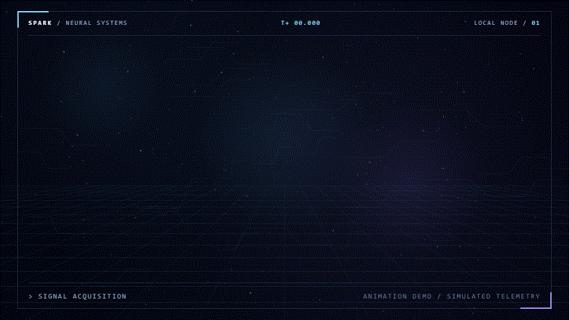
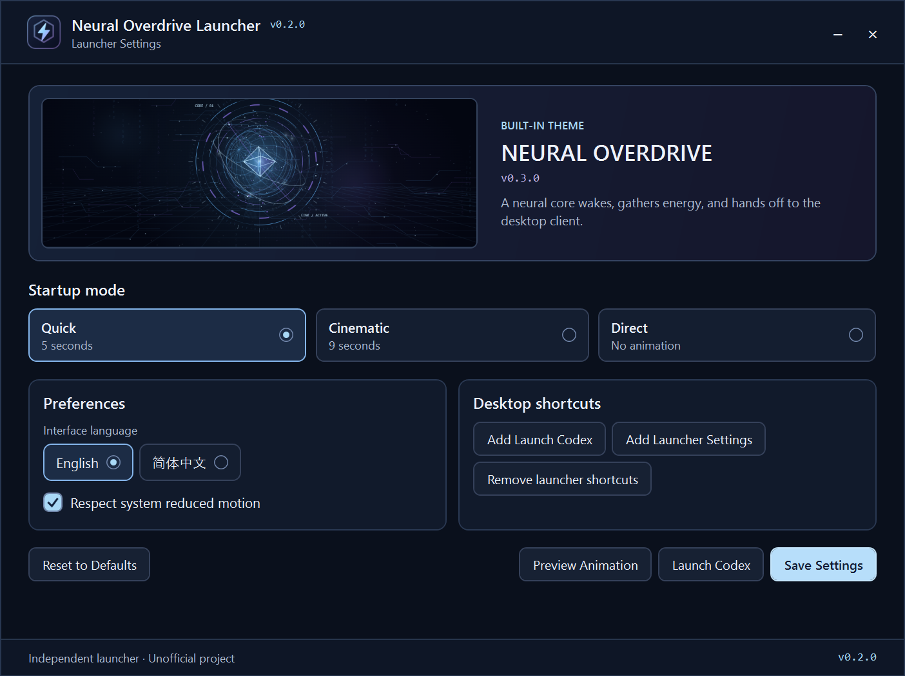

# Neural Overdrive Launcher

Neural Overdrive Launcher plays **NEURAL OVERDRIVE** while Windows opens the ChatGPT desktop app or finds its existing window. It is an unofficial Codex launcher for Windows and is unaffiliated with OpenAI.

[简体中文](README.zh-CN.md) · [v0.2.0 Beta release notes](docs/releases/v0.2.0-beta.md) · [Changelog](CHANGELOG.md)



## Features

- **Quick** and **Cinematic** play 5- and 9-second animations. **Direct** opens the Windows app entry without animation.
- **Launcher Settings** offers English and Simplified Chinese, animation-only preview, local preferences and Windows reduced-motion support.
- Create separate desktop shortcuts for daily launch and settings. Move the extracted folder to keep its local preferences.



[Simplified Chinese settings screenshot](assets/demo/settings-zh-CN.png)

## Get started

Use Windows 11 x64, the registered ChatGPT desktop app, and Evergreen WebView2 for animation. The portable ZIP includes the .NET runtime. Settings and animation-only preview work independently of ChatGPT. Windows can open ChatGPT via Direct mode or use the native launch path when the animation fails. [Microsoft WebView2 distribution guide](https://learn.microsoft.com/microsoft-edge/webview2/concepts/distribution)

1. Get `NeuralOverdriveLauncher-0.2.0-beta-win-x64.zip` and its `.sha256` file from the [v0.2.0 Beta release](https://github.com/512902Ellen/neural-overdrive-launcher/releases/tag/v0.2.0-beta). Run `Get-FileHash .\NeuralOverdriveLauncher-0.2.0-beta-win-x64.zip -Algorithm SHA256` and compare the value.
2. Extract the whole ZIP to a writable folder. Keep the executable, DLLs and `theme/` together.
3. Double-click `NeuralOverdriveLauncher.exe` to launch. The fresh default is **Quick**, a five-second animation.
4. To open settings, run `& '.\NeuralOverdriveLauncher.exe' --settings` from the extracted folder in PowerShell. In settings, use **Add Launch Codex** and **Add Launcher Settings** to create separate desktop shortcuts.

For everyday use, extract to a permanent writable folder, pick a mode and select **Save Settings**, then select **Add Launch Codex**. Open that new desktop shortcut whenever you want to launch. Keep the original Start menu entry available for direct access.

### Settings and command line

**Quick** plays for five seconds. **Cinematic** plays for nine seconds. **Direct** uses the Windows entry without animation. Select English or 简体中文 and choose whether to respect Windows reduced-motion preferences. Click **Save Settings** to use those choices on subsequent launches. **Reset to Defaults** restores the form, and **Save Settings** keeps the defaults. An animation preview uses the current controls and skips client activation. Direct previews use the Quick animation. Press Esc during the animation to dismiss it.

```powershell
& '.\NeuralOverdriveLauncher.exe' --settings
& '.\NeuralOverdriveLauncher.exe' --quick
& '.\NeuralOverdriveLauncher.exe' --preview --full
& '.\NeuralOverdriveLauncher.exe' --direct
```

Explicit `--quick`, `--full`, or `--direct` takes precedence over the saved mode. `--language en` or `--language zh-CN` selects the launcher's language for the invocation. `--respect-reduced-motion` and `--ignore-reduced-motion` override the saved motion choice for launch or preview. `--diagnostics` collects stage timings in the portable data directory. `--help` lists the options.

### Move or remove the portable copy

Close the settings and animation windows, then move the entire extracted folder to retain preferences. If you previously created desktop shortcuts, use **Remove launcher shortcuts** and add them again at the new location. To clear launcher data, close the launcher and delete `.launcher-data/` beside the EXE. That folder contains the versioned JSON preferences, isolated WebView2 data and any requested logs. To remove the launcher, remove its shortcuts from settings, then delete the extracted folder.

## Windows behavior and coverage

The launcher uses Windows app activation for the registered ChatGPT desktop app. The client chooses the resulting ChatGPT or Codex surface. Windows controls foreground access. Use the taskbar or Start if the client stays in the background. The animation displays simulated telemetry. The standalone [reference HTML](themes/neural-overdrive/reference/codex-cyber-boot-v03.html) is available in the source tree.

The unsigned Beta was exercised on Windows 11 x64. See the [release notes](docs/releases/v0.2.0-beta.md) for scenarios awaiting verification and the [acceptance guide](docs/windows-acceptance.md) for test steps.

## Build from source

Use PowerShell 7 and Node.js on Windows x64. The provisioning script downloads the pinned .NET 10 SDK and verifies the official SHA-512. SDK files, NuGet caches and build outputs stay under `.local/`. [Microsoft SDK binaries](https://dotnet.microsoft.com/en-us/download/dotnet/thank-you/sdk-10.0.404-windows-x64-binaries-zip) · [WebView2 SDK 1.0.3967.48](https://www.nuget.org/packages/Microsoft.Web.WebView2/1.0.3967.48)

```powershell
.\scripts\Install-LocalSdk.ps1
.\scripts\Build.ps1 -Restore -Test
.\scripts\Package-Portable.ps1 -Beta
```

The EXE is under `.local/neural-overdrive-launcher/win-x64/`. The local ZIP and SHA-256 sidecar are under `.local/release/`. `src/Core/` contains launch coordination and preferences. `src/Launcher/` contains the WPF interface, WebView2 host and Windows integration. `themes/` holds the reference and launcher theme. `assets/` holds the editable SVG and Windows ICO.

## License and project status

See the [third-party dependency notices](THIRD_PARTY_NOTICES.md) for bundled components and their license terms. Project-owned content is available under the [MIT License](LICENSE). Copyright © 2026 Lv Yifan.
