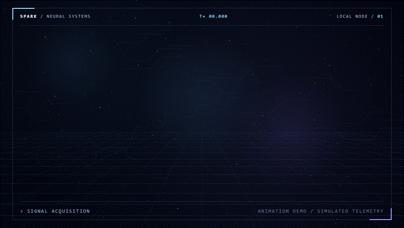
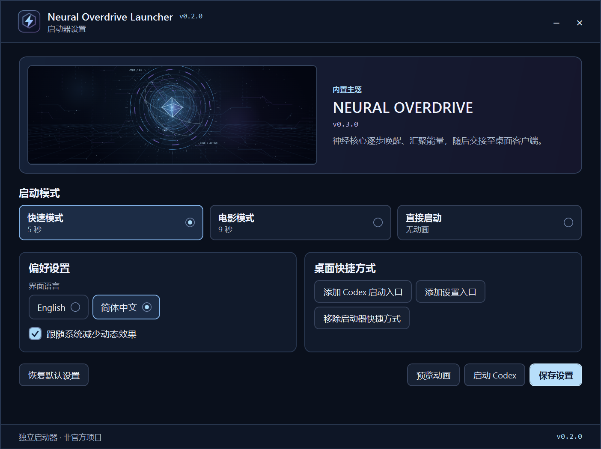

# Neural Overdrive Launcher

Neural Overdrive Launcher 在 Windows 打开 ChatGPT 桌面应用或找到已有窗口时播放 **NEURAL OVERDRIVE** 动画。这是一个非官方 Codex 启动器，与 OpenAI 无关联。

[English](README.md) · [v0.2.0 Beta 发布说明](docs/releases/v0.2.0-beta.md) · [更新记录](CHANGELOG.md)



## 功能

- 快速和电影模式分别播放 5 秒与 9 秒动画。直接模式通过 Windows 入口打开客户端。
- 设置中心支持简体中文和 English、独立动画预览、本地偏好和系统减少动态效果。
- 可分别建立日常启动与设置快捷方式。移动整个解压目录可保留偏好。



[英文设置中心截图](assets/demo/settings-en.png)

## 开始使用

当前验收基于 Windows 11 x64。启动客户端需要当前 Windows 用户已注册 ChatGPT 桌面应用，播放动画需要 Evergreen WebView2。便携包已包含 .NET 运行时。独立预览和设置中心可以在没有 ChatGPT 的环境中使用。 [Microsoft WebView2 说明](https://learn.microsoft.com/microsoft-edge/webview2/concepts/distribution)

1. 从 [v0.2.0 Beta 发布页](https://github.com/512902Ellen/neural-overdrive-launcher/releases/tag/v0.2.0-beta) 获取 `NeuralOverdriveLauncher-0.2.0-beta-win-x64.zip` 和 `.sha256`。运行 `Get-FileHash .\NeuralOverdriveLauncher-0.2.0-beta-win-x64.zip -Algorithm SHA256` 并对照校验值。
2. 将完整 ZIP 解压到有写入权限的目录，保留 EXE、DLL 与 `theme/` 的相对位置。
3. 双击 `NeuralOverdriveLauncher.exe` 启动。首次使用默认播放 5 秒快速动画。
4. 要进入设置中心，可在解压目录的 PowerShell 中运行 `& '.\NeuralOverdriveLauncher.exe' --settings`。设置页面可分别添加动画启动和设置入口的桌面快捷方式。

日常使用时，把便携包解压到固定的可写目录，选定模式并点击「保存设置」，再点击「添加 Codex 启动入口」。之后使用新建的桌面快捷方式。原有的「开始」菜单入口也可以继续使用。

## 设置与启动方式

快速模式播放 5 秒，电影模式播放 9 秒，直接启动模式不播放动画。界面可切换 English 和简体中文，也可以选择是否遵循系统减少动态效果设置。点击「保存设置」后，后续启动将使用已保存的偏好。点击「恢复默认设置」会恢复当前表单，再点击「保存设置」以保留默认值。

「预览动画」根据当前表单播放。直接启动模式下按快速模式预览。预览期间不会启动 ChatGPT。播放动画时按 Esc 可关闭动画。

```powershell
& '.\NeuralOverdriveLauncher.exe' --settings
& '.\NeuralOverdriveLauncher.exe' --quick
& '.\NeuralOverdriveLauncher.exe' --preview --full
& '.\NeuralOverdriveLauncher.exe' --direct
```

显式指定的 `--quick`、`--full` 或 `--direct` 优先于保存的启动模式。`--language en` 或 `--language zh-CN` 可指定本次启动器语言。`--respect-reduced-motion` 和 `--ignore-reduced-motion` 可覆盖本次启动或预览的动态效果偏好。用 `--diagnostics` 将阶段耗时记录到便携数据目录，或用 `--help` 查看参数。

## 移动、清理和移除

关闭启动器及设置中心后移动整个解压目录，可一同保留偏好设置。已有快捷方式时，在新位置打开设置中心，点击「移除启动器快捷方式」后重新添加。需要清理数据时，退出启动器并删除 EXE 所在目录中的 `.launcher-data/`。该目录包含版本化 JSON 配置、独立 WebView2 数据及主动开启后生成的日志。要移除启动器，请先在设置中移除快捷方式，再删除解压目录。

## 兼容性与验证范围

Windows 原生入口使用已注册的 ChatGPT 应用。客户端决定实际显示 ChatGPT 还是 Codex 界面，由 Windows 决定前台焦点。如果客户端留在后台，可以从任务栏或「开始」菜单切换。动画中的遥测数据为模拟。冷启动、真实缺少 WebView2 和混合 DPI 等仍需按 [Windows 验收流程](docs/windows-acceptance.md) 检查。当前本地便携包未签名。

## 构建与许可

在 Windows x64 上使用 PowerShell 7 和 Node.js，按 [英文 README](README.md#build-from-source) 构建。SDK、缓存、构建产物和便携包都位于 `.local/`。

项目自有内容采用 [MIT 许可证](LICENSE)，版权所有 © 2026 Lv Yifan。便携包附有 Microsoft 组件的许可证和声明。详见 [第三方依赖声明](THIRD_PARTY_NOTICES.md)。
